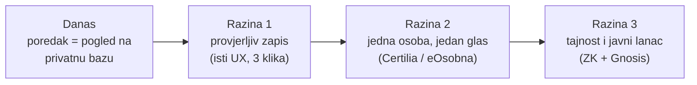
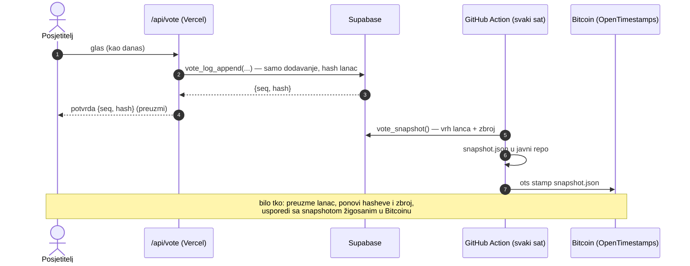
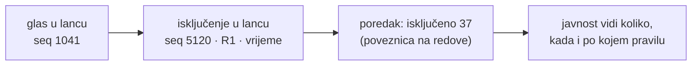
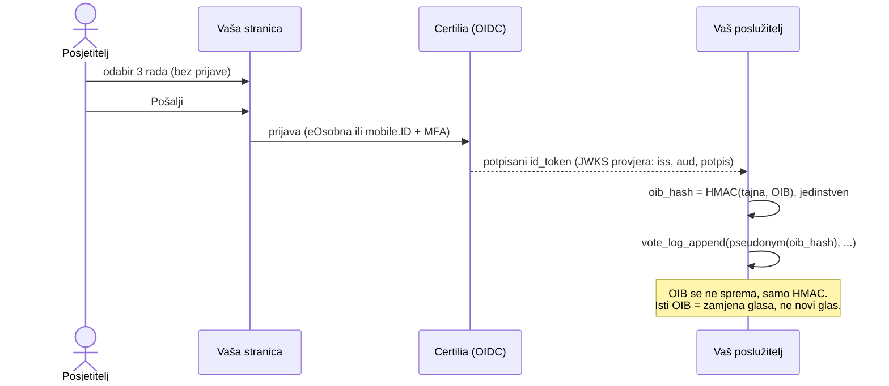
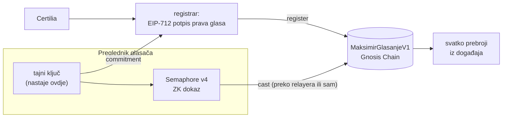

# Kako anketu na maksimirski-stadion.org učiniti provjerljivom

**Za:** Nenad Bakić, maksimirski-stadion.org\
**Od:** Matija Stepanić, maksimir.domovina.ai\
**Datum:** 30. 9. 2026.

Poštovani gospodine Bakiću,

Vaša anketa je brza, pregledna i iskreno opisana: u „O projektu” sami pišete da je to „zabavna
anketa bez provjere identiteta” i da „tko se jako potrudi, može glasati više puta”. Ovaj dokument
ne osporava to što ste napravili. Nudi konkretne korake kojima bi rezultat, uz isto korisničko
iskustvo, mogao dobiti ono što mu danas nedostaje: **mogućnost da ga bilo tko izvana provjeri.**

Svaki korak ima gotovu, otvorenu implementaciju (MIT) u našem repozitoriju
[`stepanic/stadion-maksimir-natjecaj-2026`](https://github.com/stepanic/stadion-maksimir-natjecaj-2026),
koju možete preuzeti ili prilagoditi. Poveznice vode na fiksni commit, pa se neće pomaknuti.

Analiza se temelji isključivo na onome što Vaša stranica javno isporučuje pregledniku i na Vašim
tekstovima „O projektu” i „Privatnost”. Nismo slali glasove niti dirali Vaš API.

## Sažetak

Koraci su podijeljeni u tri razine. **Razina 1 ne mijenja ništa za posjetitelja**: i dalje se glasa
u tri klika, bez prijave. Već ona rješava najveći problem, a to je da danas nitko izvan Vaše baze ne
može znati je li poredak točan.



| Što rezultat može dokazati | Danas | Razina 1 | Razina 2 | Razina 3 |
|---|---|---|---|---|
| Da nijedan predani glas nije naknadno izmijenjen ili obrisan | ne | **da** | da | da |
| Da zbroj na stranici odgovara zapisu | ne | **da** | da | da |
| Da glasač može provjeriti da je njegov glas u zbroju | ne | **da** | da | da |
| Da su isključeni glasovi javno i po pravilu isključeni | ne | **da** | da | da |
| Da je svaki glas druga osoba | ne | ne | **da** | da |
| Da operater ne zna kako je tko glasao | da (nema identiteta) | da | ne | **da** (uz uvjete, vidi dolje) |
| Da nitko, ni operater, ne treba povjerenje za zbroj | ne | djelomično | djelomično | **da** |
| Trenje za posjetitelja | 3 klika | 3 klika | prijava | prijava, ključ |

---

## Razina 1: provjerljiv zapis, bez promjene za posjetitelja

Pet koraka. Svi rade na Vašem postojećem stacku (Next.js na Vercelu, Supabase), bez prijave i bez
blockchaina.



### Korak 1.1: zapis glasova koji se može samo dopunjavati (hash lanac)

Umjesto da se glas upisuje i prepisuje u tablici (upsert po oznaci preglednika), svaka predaja,
zamjena i isključenje dodaje **novi red**. Svaki red sadrži hash prethodnog, pa promjena bilo kojeg
starog reda mijenja sve hasheve iza njega.

Primjer za Supabase (Postgres, `pgcrypto`):

```sql
create extension if not exists pgcrypto with schema extensions;

create table public.vote_log (
  seq        bigint primary key,
  prev_hash  text   not null,
  hash       text   not null,
  pseudonym  text   not null,  -- sha256('mks:' || HMAC(voterId)): ne otkriva preglednik
  kind       text   not null check (kind in ('vote', 'exclude')),
  codes      text   not null,  -- 'ŠIFRA1,ŠIFRA2,ŠIFRA3' sortirano; '' kod isključenja
  reason     text,             -- kod isključenja: oznaka pravila (npr. 'R1-nalet')
  ts_ms      bigint not null
);

create function public.vote_log_append(p_pseudonym text, p_kind text, p_codes text, p_reason text default null)
returns public.vote_log language plpgsql security definer set search_path = '' as $$
declare v_prev public.vote_log; v public.vote_log;
begin
  perform pg_advisory_xact_lock(hashtext('vote_log'));        -- jedan po jedan
  select * into v_prev from public.vote_log order by seq desc limit 1;
  v.seq       := coalesce(v_prev.seq, -1) + 1;
  v.prev_hash := coalesce(v_prev.hash, repeat('0', 64));
  v.pseudonym := p_pseudonym; v.kind := p_kind; v.codes := p_codes; v.reason := p_reason;
  v.ts_ms     := (extract(epoch from clock_timestamp()) * 1000)::bigint;
  v.hash      := encode(extensions.digest(concat_ws('|',
                   v.prev_hash, v.seq, v.pseudonym, v.kind, v.codes, coalesce(v.reason, ''), v.ts_ms),
                 'sha256'), 'hex');
  insert into public.vote_log values (v.*);
  return v;
end $$;

create function public.vote_log_immutable() returns trigger language plpgsql as $$
begin raise exception 'vote_log se smije samo dopunjavati'; end $$;

create trigger vote_log_no_change before update or delete on public.vote_log
  for each row execute function public.vote_log_immutable();
create trigger vote_log_no_truncate before truncate on public.vote_log
  for each statement execute function public.vote_log_immutable();
```

Trenutni glas oznake preglednika je njezin zadnji red. Zbroj se računa iz lanca, a tablicu zbrojeva
može se i dalje držati radi brzine, uz uvjet da se svaki sat provjerava prema lancu.

Trigger sprječava slučajnu izmjenu, ali administrator baze ga može ukloniti. Zato je potreban
korak 1.2: tek vanjski žig čini tajnu izmjenu otkrivom.

**Kod nas:** formula lanca i pravila u
[`glasanje/README.md` → „Kako je zaštićen integritet”](https://github.com/stepanic/stadion-maksimir-natjecaj-2026/blob/e20c5cb4e9fe52cb967183f9065291823031f5f7/glasanje/README.md#kako-je-zaštićen-integritet)
i
[`docs/glasanje-kako-radi.md` → Korak 4: lanac hasheva](https://github.com/stepanic/stadion-maksimir-natjecaj-2026/blob/e20c5cb4e9fe52cb967183f9065291823031f5f7/docs/glasanje-kako-radi.md#korak-4-lanac-hasheva).

### Korak 1.2: satni snapshot žigosan u Bitcoinu (OpenTimestamps)

Javna funkcija `vote_snapshot()` vraća vrh lanca (`seq`, `hash`) i trenutni zbroj iz iste
transakcije. GitHub Action je svaki sat pročita, zapiše JSON u javni repozitorij i žigoše ga
OpenTimestampsom. Nakon nekoliko sati žig dobiva Bitcoin atestaciju. Od tada nitko, pa ni Vi, ne
može prepisati stanje iz tog sata a da se to ne vidi. Trošak je nula: OpenTimestamps je besplatan,
a Action ne treba nikakvu tajnu.

**Kod nas (gotovo, radi od 25. 9. 2026.):**
- skripta [`scripts/maksimir_checkpoint.py`](https://github.com/stepanic/stadion-maksimir-natjecaj-2026/blob/e20c5cb4e9fe52cb967183f9065291823031f5f7/scripts/maksimir_checkpoint.py)
- workflow [`.github/workflows/maksimir-checkpoint.yml`](https://github.com/stepanic/stadion-maksimir-natjecaj-2026/blob/e20c5cb4e9fe52cb967183f9065291823031f5f7/.github/workflows/maksimir-checkpoint.yml)
- rezultati: [`glasanje/checkpoints/`](https://github.com/stepanic/stadion-maksimir-natjecaj-2026/tree/e20c5cb4e9fe52cb967183f9065291823031f5f7/glasanje/checkpoints) (`.json` + `.ots`)
- opis: [Korak 6: satni snapshot u Bitcoinu](https://github.com/stepanic/stadion-maksimir-natjecaj-2026/blob/e20c5cb4e9fe52cb967183f9065291823031f5f7/docs/glasanje-kako-radi.md#korak-6-satni-snapshot-u-bitcoinu)

### Korak 1.3: potvrda glasaču

Nakon predaje `/api/vote` uz `{ok, codes, replaced}` vraća i `{seq, hash}` reda u lancu. Stranica
ponudi „Preuzmi potvrdu”. Kad se lanac objavi, glasač sam provjeri da je njegov red na mjestu i da
ga nitko nije promijenio. Potvrda ne otkriva tko je glasač.

**Kod nas:** [Korak 5: potvrda za glasača](https://github.com/stepanic/stadion-maksimir-natjecaj-2026/blob/e20c5cb4e9fe52cb967183f9065291823031f5f7/docs/glasanje-kako-radi.md#korak-5-potvrda-za-glasača);
provjera: `maksimir_verify.py LANAC.json --receipt POTVRDA.json`.

### Korak 1.4: javni lanac i skripta za neovisnu provjeru

Pseudonimizirani lanac (`seq, prev_hash, hash, pseudonym, kind, codes, reason, ts_ms`) objavite
kao datoteku ili javni endpoint, barem na kraju ankete, a po mogućnosti uživo. Uz njega ide kratka
skripta koja ponovno izračuna sve hasheve, ponovno zbroji glasove i usporedi ih sa snapshotovima
iz koraka 1.2.

Pritom **lanac ne brišite 30 dana nakon ankete**. U lancu nema osobnih podataka, samo pseudonimi i
šifre radova. Brisanje sažetka IP adrese nakon 2 dana može ostati kakvo je.

**Kod nas:** skripta [`scripts/maksimir_verify.py`](https://github.com/stepanic/stadion-maksimir-natjecaj-2026/blob/e20c5cb4e9fe52cb967183f9065291823031f5f7/scripts/maksimir_verify.py)
(samo standardna biblioteka Pythona, funkcija `verify_chain` od retka 54), objavljeni lanac
[`glasanje/faza1/lanac.json`](https://github.com/stepanic/stadion-maksimir-natjecaj-2026/blob/e20c5cb4e9fe52cb967183f9065291823031f5f7/glasanje/faza1/lanac.json),
opis [Korak 7: neovisna provjera](https://github.com/stepanic/stadion-maksimir-natjecaj-2026/blob/e20c5cb4e9fe52cb967183f9065291823031f5f7/docs/glasanje-kako-radi.md#korak-7-neovisna-provjera).

### Korak 1.5: isključivanje kao zapis, ne kao brisanje

Pravila kažu da očite pokušaje namještanja možete isključiti i da ćete to javno navesti. Predlažemo
da se to radi ovako:

1. Unaprijed objavite pravila s oznakama (npr. `R1`: više od N glasova s iste mreže u M minuta).
2. Isključenje je novi red u lancu (`kind = 'exclude'`, `reason = 'R1'`), a ne brisanje ili filtar.
3. Poredak prikazuje „isključeno: X glasova” s poveznicom na te redove.

Tako svatko vidi koliko je isključeno, kada i po kojem pravilu. Isključenje ostaje odluka
operatera, ali više nije nevidljivo.



### Korak 1.6: kôd i uokvirenje

- **Objavite barem rutu `/api/vote` i SQL.** Danas se pravila (limit po mreži, isključivanje) znaju
  samo iz opisa. Source mapovi vraćaju 403.
- **Riječ „anketa” stavite i na naslovnicu.** Naslov kartice danas glasi „Javno glasanje”, a ograda
  „zabavna anketa bez provjere identiteta” stoji tek na poretku i u „O projektu”. Brojka se u
  medijima citira bez ograde. Uz poredak bi preciznije bilo „N oznaka preglednika” nego „N glasača”.

**Rezultat razine 1.** Za posjetitelja se ništa ne mijenja. Više osoba i dalje može glasati više
puta, ali **nitko, ni Vi ni napadač na bazi, više ne može tiho promijeniti, obrisati ili isključiti
glas.** Svatko može sam prebrojati rezultat.

---

## Razina 2: jedna osoba, jedan glas (Certilia / eOsobna)

Ako želite da brojka znači broj **ljudi**, potreban je identitet. U Hrvatskoj je to Certilia
(eOsobna ili mobile.ID na mobitelu). Posjetitelj i dalje bira radove bez prijave, a prijava se
traži tek pri predaji.



Što je potrebno:

1. Ugovor s Certilijom (AKD) kao pouzdajuća strana (OIDC klijent).
2. Poslužiteljska provjera `id_token`a preko JWKS-a (potpis, `iss`, `aud`). OIB se nikad ne prima
   od preglednika, nego samo iz provjerenog tokena.
3. `oib_hash = HMAC(tajni ključ, OIB)` kao jedinstveni ključ glasača. Pseudonim u lancu iz koraka
   1.1 računa se iz njega.

**Kod nas:** klijentski dio (Certilia popup + polling) je javan u
[`web/src/glasanje.ts`](https://github.com/stepanic/stadion-maksimir-natjecaj-2026/blob/e20c5cb4e9fe52cb967183f9065291823031f5f7/web/src/glasanje.ts),
a tok je opisan u
[Korak 1: prijava eOsobnom](https://github.com/stepanic/stadion-maksimir-natjecaj-2026/blob/e20c5cb4e9fe52cb967183f9065291823031f5f7/docs/glasanje-kako-radi.md#korak-1-prijava-eosobnom)
i
[Korak 2: od identiteta do glasača](https://github.com/stepanic/stadion-maksimir-natjecaj-2026/blob/e20c5cb4e9fe52cb967183f9065291823031f5f7/docs/glasanje-kako-radi.md#korak-2-od-identiteta-do-glasača).
Poslužiteljski dio (edge funkcija za provjeru tokena i SQL) je u drugom, zasad nejavnom repozitoriju
`domovina-api`. Ako Vam zatreba, rado ga pokažemo.

**Cijena.** Trenje raste i broj sudionika će pasti. Naš sustav to jasno pokazuje: 29. 9. je na
lancu imao 1 glasača, a Vaša anketa 6.799 oznaka preglednika.

---

## Razina 3: tajnost glasa i javni lanac

Razina 2 uvodi novi problem: operater zna tko je glasao. Razina 3 ga rješava tako da identitet
služi samo za **pravo** glasa, a sam listić je anonimni ZK dokaz na javnom lancu.



**Kod nas (gotovo, na Gnosis Chainu od 26. 9. 2026.):**
- ugovor [`chain/contracts/v1/MaksimirGlasanjeV1.sol`](https://github.com/stepanic/stadion-maksimir-natjecaj-2026/blob/e20c5cb4e9fe52cb967183f9065291823031f5f7/chain/contracts/v1/MaksimirGlasanjeV1.sol)
  (`register` od retka 133, `cast` od retka 154), na adresi
  [`0x8129…E869`](https://gnosisscan.io/address/0x812960FA1120121DEd82A8806aECE93dcf49E869) s verificiranim kodom
- ZK u pregledniku [`web/src/zk.ts`](https://github.com/stepanic/stadion-maksimir-natjecaj-2026/blob/e20c5cb4e9fe52cb967183f9065291823031f5f7/web/src/zk.ts),
  listić na lancu [`web/src/chainVote.ts`](https://github.com/stepanic/stadion-maksimir-natjecaj-2026/blob/e20c5cb4e9fe52cb967183f9065291823031f5f7/web/src/chainVote.ts)
- relayer [`web/worker/relayer/relay.ts`](https://github.com/stepanic/stadion-maksimir-natjecaj-2026/blob/e20c5cb4e9fe52cb967183f9065291823031f5f7/web/worker/relayer/relay.ts):
  plaća gas, a listić ne može ni promijeniti ni zadržati
- arhitektura [`docs/blockchain/01-arhitektura.md`](https://github.com/stepanic/stadion-maksimir-natjecaj-2026/blob/e20c5cb4e9fe52cb967183f9065291823031f5f7/docs/blockchain/01-arhitektura.md),
  tko što može [`docs/blockchain/06-kontrola-glasaca.md`](https://github.com/stepanic/stadion-maksimir-natjecaj-2026/blob/e20c5cb4e9fe52cb967183f9065291823031f5f7/docs/blockchain/06-kontrola-glasaca.md)

Ova razina je velik posao i za jednostavnu anketu vjerojatno nije potrebna. Navodimo je da bi bilo
jasno gdje je gornja granica.

---

## Što je kod Vas bolje nego kod nas

- **Nasumičan redoslijed radova** po sesiji (mulberry32, Fisher–Yates, gumb „promiješaj”). Mi
  imamo statičan redoslijed i to ćemo preuzeti od Vas.
- **Nisko trenje i odaziv.**
- **Privatnost prema operateru:** Vi ne znate tko je glasao. Mi to na razini 2 znamo, a potpuna
  tajnost prema operateru kod nas još nije riješena.

## Što ni naše rješenje još nema

Da ne ostane dojam da je naš sustav bez mana, ovo su javno popisani otvoreni nalazi:

- Registrar je točka povjerenja: operater bi mogao upisati izmišljene glasače. Svaki upis je
  doduše javna transakcija, pa bi se napuhavanje vidjelo.
- Operater može povezati osobu i listić po vremenu registracije (nalazi F-01 i F-13).
- Odjava ne briše ključ glasača iz preglednika, a s jednim glasačem rezultat otkriva njegov listić
  (nalazi O-1 i O-3).
- Poslužiteljski dio (`domovina-api`) još nije javan.

Izvori:
[neovisni review 1](https://github.com/stepanic/stadion-maksimir-natjecaj-2026/blob/e20c5cb4e9fe52cb967183f9065291823031f5f7/docs/review/2026-09-26-neovisni-review-glasanje.md),
[neovisni review 2](https://github.com/stepanic/stadion-maksimir-natjecaj-2026/blob/e20c5cb4e9fe52cb967183f9065291823031f5f7/docs/review/2026-09-26-neovisni-review-wiring.md),
[nalazi obilaska O-1…O-6](https://github.com/stepanic/stadion-maksimir-natjecaj-2026/blob/e20c5cb4e9fe52cb967183f9065291823031f5f7/docs/2026-09-29-glasanje-obilazak-kao-posjetitelj.md),
[„Što sustav ne rješava”](https://github.com/stepanic/stadion-maksimir-natjecaj-2026/blob/e20c5cb4e9fe52cb967183f9065291823031f5f7/docs/glasanje-kako-radi.md#što-sustav-ne-rješava).

## Prijedlog

Razina 1 je po našoj procjeni posao od nekoliko dana, a sve dijelove možete preuzeti pod MIT
licencom. Rado ćemo pomoći: pregledati Vaš SQL, prilagoditi skriptu za provjeru Vašem formatu ili
postaviti satni žig.

Srdačan pozdrav,
Matija Stepanić
stepanic.matija@gmail.com · [maksimir.domovina.ai](https://maksimir.domovina.ai)
